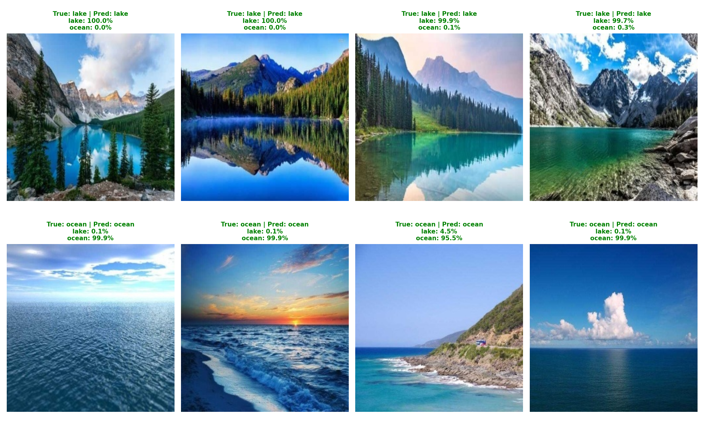
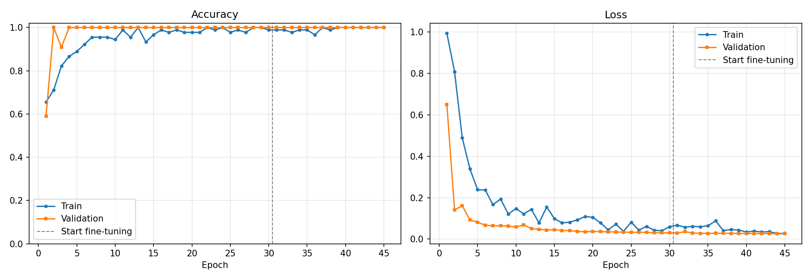
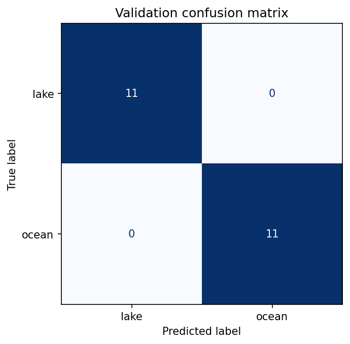

# 🌊 Lake vs Ocean Classifier (CNN)

A convolutional neural network that tells **lake** photos from **ocean** photos and gives the percentage for each class.
Made for the Machine Learning Classification Project, KMITL.

**🔗 Web app (Streamlit):** https://lake-ocean-classifier-glc7ome7lwcokmzq2vg6wj.streamlit.app
If it says *"This app has gone to sleep"*, click **Yes, get this app back up!** and wait about a minute.

**🔗 Backup web app (GitHub Pages, never sleeps):** https://tnnumb.github.io/lake-ocean-classifier/
This version runs the model inside your browser with ONNX Runtime Web, so your photo is never uploaded.

**📓 Notebook:** [Open in Google Colab](https://colab.research.google.com/github/tnnumb/lake-ocean-classifier/blob/main/Lake_vs_Ocean_CNN.ipynb)

## Results

| | Accuracy |
|---|---|
| Validation (22 images) | **100%** |
| Test (8 images: 4 lake, 4 ocean) | **100%** |

| Test image | Lake % | Ocean % | Prediction |
|---|---|---|---|
| lake_test_1 | 100.0 | 0.0 | ✅ lake |
| lake_test_2 | 100.0 | 0.0 | ✅ lake |
| lake_test_3 | 99.9 | 0.1 | ✅ lake |
| lake_test_4 | 99.7 | 0.3 | ✅ lake |
| ocean_test_1 | 0.1 | 99.9 | ✅ ocean |
| ocean_test_2 | 0.1 | 99.9 | ✅ ocean |
| ocean_test_3 | 4.5 | 95.5 | ✅ ocean |
| ocean_test_4 | 0.1 | 99.9 | ✅ ocean |

These are the notebook results. The web apps read the original JPG files instead of the re-saved copies the notebook used, so a few percentages differ by a few tenths of a percent (for example ocean_test_3: 94.8% ocean). Every predicted class is the same.

## Model

Transfer learning: a CNN pre-trained on ImageNet (MobileNetV2) with a new classifier trained on our photos.

| Item | Setting |
|---|---|
| Input | 224 × 224 × 3 |
| Data augmentation | Horizontal flip, rotation ±18°, zoom ±10%, shift ±5% (training only) |
| CNN base | MobileNetV2, 154 layers, ImageNet weights; top 30 layers fine-tuned |
| Classifier head | Global Average Pooling (1280) → Dropout 0.4 → Dense 128 ReLU → Dropout 0.4 → Dense 2 softmax |
| Parameters | 2,422,210 |
| Optimizer | Adam, lr 0.001 (stage 1), 0.00001 (stage 2 fine-tuning) |
| Loss | Sparse categorical cross-entropy |
| Epochs | 30 (stage 1) + 15 (stage 2), early stopping (patience 6) |
| Batch size | 16 |

## Data

- 60 lake + 60 ocean images for training; 4 lake + 4 ocean test images.
- 8 training images were exact copies of the test images, so they were removed from training to keep the test fair.
- Final split: **90 train · 22 validation (24% of train) · 8 test**.

## Files

| File | What it is |
|---|---|
| `streamlit_app.py` | The Streamlit web app |
| `requirements.txt` | Libraries for the Streamlit app |
| `index.html` | The backup webpage (GitHub Pages, runs in the browser) |
| `model.onnx` | Trained model in ONNX format, used by both web apps |
| `lake_ocean_model.keras` | Trained Keras model |
| `Lake_vs_Ocean_CNN.ipynb` | Google Colab notebook: data cleaning, training, testing |
| `lake_test_*.jpg`, `ocean_test_*.jpg` | The 8 test images |
| `training_curves.png`, `confusion_validation.png`, `test_predictions.png` | Result figures |

## Run it yourself

1. Open the notebook in Google Colab (link above) and choose **Runtime → Change runtime type → T4 GPU**.
2. **Runtime → Run all**, then upload a zip of the image folder when asked.

Built with TensorFlow / Keras, Google Colab, ONNX Runtime and Streamlit.
